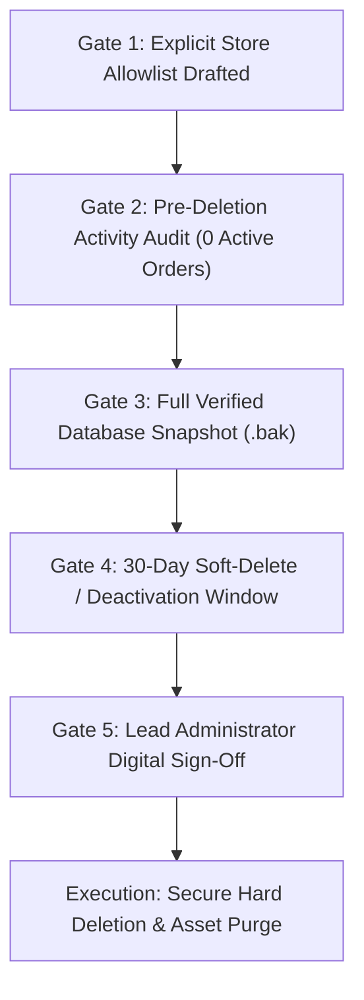

# WatsStore — Demo Store Deletion & Archival Approval Plan

**Governance Policy:** Production Data Protection & Deletion Gate  
**Compliance Standard:** Multi-Tenant Isolation & Anti-Data Loss Protocol  
**Authorized Roles:** Lead Administrator / System Architect Only  

---

## 1. Safety Mandate

> [!IMPORTANT]
> **Zero Unapproved Deletions:**  
> No store record may be deleted from the production database without completing all five pre-deletion verification gates outlined in this document.

---

## 2. Five Pre-Deletion Verification Gates



### Gate 1: Explicit Store Allowlist
The administrator must prepare a CSV / JSON allowlist containing:
- `StoreId`
- `StoreSlug`
- `RegisteredEmail`
- `ReasonForDeletion` (e.g., "Internal test fixture created during automated testing")

*Any store not explicitly included in the allowlist is automatically skipped.*

### Gate 2: Pre-Deletion Activity Audit
Run the following audit query to confirm the target store is not an active merchant and has zero real customer orders:

```sql
SELECT 
    s.[Id], 
    s.[StoreName], 
    s.[Slug], 
    s.[Email], 
    s.[CreatedAt],
    (SELECT COUNT(1) FROM [Orders] o WHERE o.[StoreId] = s.[Id]) AS TotalOrders,
    (SELECT COUNT(1) FROM [Products] p WHERE p.[StoreId] = s.[Id]) AS TotalProducts
FROM [Stores] s
WHERE s.[Slug] IN ('target-test-store-slug');
```
*If `TotalOrders > 0`, the deletion request is immediately aborted.*

### Gate 3: Full Verified Database Snapshot
1. Generate an on-demand SQL Server backup:
   ```sql
   BACKUP DATABASE [watsstore_prod] 
   TO DISK = N'/backups/watsstore_pre_deletion_snapshot_20261103.bak' 
   WITH CHECKSUM, COMPRESSION;
   ```
2. Verify backup integrity:
   ```sql
   RESTORE VERIFYONLY FROM DISK = N'/backups/watsstore_pre_deletion_snapshot_20261103.bak';
   ```

### Gate 4: 30-Day Soft-Delete / Deactivation Window
Instead of immediate permanent deletion, deactivate the store first:
```sql
UPDATE [Stores] 
SET 
    [IsActive] = 0, 
    [StoreName] = CONCAT('[ARCHIVED] ', [StoreName]),
    [Slug] = CONCAT('archived-', [Slug], '-', DATEDIFF(SECOND, '1970-01-01', GETUTCDATE()))
WHERE [Id] = 'TARGET_STORE_ID';
```
Wait 30 days. If no merchant claims the account, proceed to Gate 5.

### Gate 5: Administrator Sign-Off
A written confirmation log must be recorded with:
- Execution Admin: `System Administrator`
- Execution Timestamp (UTC)
- Backup Verification Checksum

---

## 3. Permanent Deletion Execution Script (Post-Approval Only)

When all 5 gates have passed:

```sql
BEGIN TRANSACTION;

DECLARE @TargetStoreId NVARCHAR(450) = 'APPROVED_STORE_ID_HERE';

-- 1. Delete associated OTP challenges
DELETE FROM [MerchantOtpChallenges] WHERE [StoreId] = @TargetStoreId;

-- 2. Delete merchant reviews
DELETE FROM [MerchantReviews] WHERE [StoreId] = @TargetStoreId;

-- 3. Delete coupons
DELETE FROM [StoreCoupons] WHERE [StoreId] = @TargetStoreId;

-- 4. Delete orders and items (if test fixtures only)
DELETE oi FROM [OrderItems] oi
INNER JOIN [Orders] o ON oi.[OrderId] = o.[Id]
WHERE o.[StoreId] = @TargetStoreId;

DELETE FROM [Orders] WHERE [StoreId] = @TargetStoreId;

-- 5. Delete products
DELETE FROM [Products] WHERE [StoreId] = @TargetStoreId;

-- 6. Delete categories
DELETE FROM [Categories] WHERE [StoreId] = @TargetStoreId;

-- 7. Delete store
DELETE FROM [Stores] WHERE [Id] = @TargetStoreId;

-- Verify single row deleted
IF @@ROWCOUNT = 1
BEGIN
    COMMIT TRANSACTION;
    PRINT 'Store and related test entities successfully purged.';
END
ELSE
BEGIN
    ROLLBACK TRANSACTION;
    PRINT 'Error: Store deletion aborted due to unexpected row count.';
END
```

---

## 4. Audit Trail Log

Every deletion event must be documented in `PLATFORM_SECURITY_DELETION_LOG.md` including target StoreId, date, reason, and backup reference.
