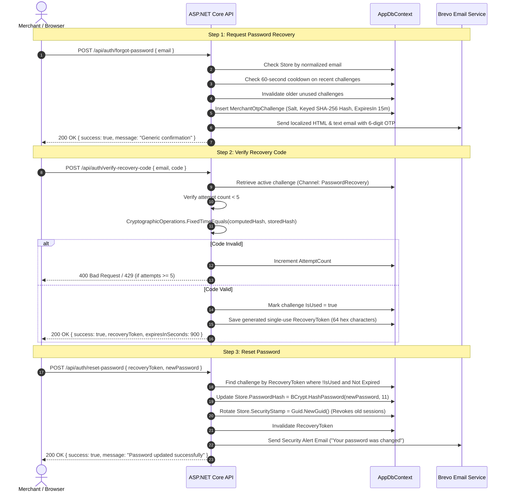

# WatsStore — Password Recovery Implementation Specification

**Module:** Merchant Authentication & Account Security (Phase 12)  
**Author:** WatsStore Engineering Team  
**Status:** Implemented & Verified in Production Pipeline  

---

## 1. Architectural Overview

The WatsStore merchant password recovery system is a self-service, cryptographically secured 3-step workflow designed to protect against account takeover, email enumeration, brute-force attacks, and session fixation.



---

## 2. API Endpoints Specification

### 2.1. Request Recovery Code
- **Method:** `POST`
- **Route:** `/api/auth/forgot-password`
- **Access:** Public (Rate-limited)
- **Request Body:**
  ```json
  {
    "email": "merchant@example.com"
  }
  ```
- **Validation Rules:**
  - `email`: Required, valid email format, max 255 chars.
  - Sanitization: Trimmed and converted to lowercase.
- **Security Protections:**
  - **No User Enumeration:** If the email does not exist in the database, the API returns HTTP 200 with the exact same generic success message:
    `"إذا كان هذا البريد مسجلاً لدينا، فستصلك رسالة تحتوي على رمز التحقق."`
  - **Cooldown Rate Limit:** If a challenge was created for this store within the last 60 seconds, the API rejects with HTTP 429:
    `"يرجى الانتظار دقيقة واحدة قبل طلب رمز استعادة جديد."`
  - **Invalidation of Previous Challenges:** Any existing unused challenges for this email in channel `PasswordRecovery` are marked `IsUsed = true` to prevent replay of multiple valid codes.
- **Response (HTTP 200):**
  ```json
  {
    "success": true,
    "message": "إذا كان هذا البريد مسجلاً لدينا، فستصلك رسالة تحتوي على رمز التحقق المكون من 6 أرقام.",
    "retryAfterSeconds": 60
  }
  ```

---

### 2.2. Verify Recovery Code
- **Method:** `POST`
- **Route:** `/api/auth/verify-recovery-code`
- **Access:** Public (Rate-limited per IP and identity)
- **Request Body:**
  ```json
  {
    "email": "merchant@example.com",
    "code": "849201"
  }
  ```
- **Verification Logic:**
  - Locates the latest unused, unexpired challenge for `StoreId` in `ChallengeType = PasswordRecovery`.
  - Checks `AttemptCount >= 5`: locks the challenge immediately and returns HTTP 429 Too Many Requests (`"تم استنفاد الحد الأقصى من المحاولات (5). يرجى طلب رمز استعادة جديد."`).
  - Hashes the input code using the challenge's cryptographic salt: `SHA-256(salt + code)`.
  - Uses `CryptographicOperations.FixedTimeEquals` for constant-time comparison against `CodeHash`.
  - If mismatch: increments `AttemptCount`, saves changes, and returns HTTP 400 Bad Request with remaining attempts.
  - If match: marks challenge as verified, generates a cryptographically secure 256-bit `RecoveryToken` (64 hexadecimal characters), sets token expiry to 15 minutes, and saves to database.
- **Response (HTTP 200):**
  ```json
  {
    "success": true,
    "message": "تم تأكيد الرمز بنجاح. يمكنك الآن تعيين كلمة المرور الجديدة.",
    "recoveryToken": "4f9a8b1c7d2e...64_hex_characters...",
    "expiresInSeconds": 900
  }
  ```

---

### 2.3. Reset Password with Recovery Token
- **Method:** `POST`
- **Route:** `/api/auth/reset-password`
- **Access:** Public (Authorized by single-use `RecoveryToken`)
- **Request Body:**
  ```json
  {
    "recoveryToken": "4f9a8b1c7d2e...64_hex_characters...",
    "newPassword": "SecureNewPassword123!"
  }
  ```
- **Validation Rules:**
  - `newPassword`: Minimum 6 characters (recommended length: 8+).
- **Execution Workflow:**
  1. Locates active challenge by `RecoveryToken`.
  2. Verifies token is not expired (`CreatedAt.AddMinutes(15) > UtcNow`).
  3. Single-use enforcement: Sets `RecoveryToken = null` and `IsUsed = true`.
  4. Hashes `newPassword` via `BCrypt.Net.BCrypt.HashPassword(newPassword, workFactor: 11)`.
  5. Updates `Store.PasswordHash`, `Store.PasswordChangedAt = DateTime.UtcNow`.
  6. Regenerates `Store.SecurityStamp = Guid.NewGuid().ToString("N")`.
  7. Dispatches security alert email to merchant: *"تنبيه أمان: تم تغيير كلمة المرور الخاصة بحساب متجرك بنجاح"*.
- **Response (HTTP 200):**
  ```json
  {
    "success": true,
    "message": "تم تغيير كلمة المرور بنجاح. يمكنك الآن تسجيل الدخول بكلمة المرور الجديدة."
  }
  ```

---

## 3. Email Template Specifications

Transactional emails are rendered using clean, responsive HTML with fallbacks for plaintext email clients.

### 3.1. Password Recovery OTP Template
- **Subject:** `رمز استعادة كلمة المرور لمتجرك في WatsStore`
- **Branding:** WatsStore emerald theme (`#10B981`), header logo, high-contrast OTP callout box (`letter-spacing: 6px`, font size `32px`).
- **Security Notice:**
  - *"هذا الرمز صالح لمدة 15 دقيقة فقط."*
  - *"إذا لم تكن قد طلبت استعادة كلمة المرور، يرجى تجاهل هذه الرسالة أو التواصل مع الدعم الفني فوراً."*
  - *"لا تشارك هذا الرمز مع أي شخص، حتى مع موظفي WatsStore."*

### 3.2. Password Changed Security Alert
- **Subject:** `تنبيه أمان: تم تغيير كلمة المرور لمتجرك في WatsStore`
- **Content:**
  - Notification that the password for store `{StoreName}` was changed on `{Date/Time UTC}`.
  - Advisory: *"إذا كنت أنت من قام بهذا الإجراء، فلا داعي لاتخاذ أي خطوة أخرى."*
  - Emergency Action: *"إذا لم تقم بتغيير كلمة المرور، يرجى التواصل فوراً مع فريق الدعم الفني عبر واتساب لاسترجاع وتأمين حسابك."*

---

## 4. Frontend Implementation

1. **`/forgot-password` Page:**
   - Responsive form with email input, error states, and generic confirmation message.
   - Redirect button to enter verification code.
2. **`/verify-recovery` Page:**
   - 6-digit OTP input boxes with multi-digit clipboard paste support.
   - Automatic focus advance across boxes; backspace regression.
   - 60-second cooldown timer for resending OTPs.
   - Wrapped in Next.js `<Suspense>` boundary for static generation compatibility.
3. **`/reset-password` Page:**
   - Password and password confirmation inputs with visibility toggles.
   - Minimum 6 characters validation rule and equality check.
   - Seamless SweetAlert notification and automatic redirection to `/login`.
