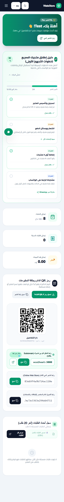
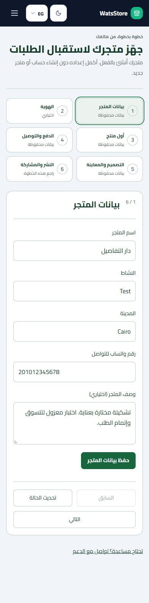

# Phase 05 merchant onboarding audit

Application revision: `2426469137ba8fb50e6d97448e26dee390dbef15`. Final release status and CI: [release report](PHASE05_FINAL_RELEASE_REPORT.md).

## Existing behavior and gaps

Registration already created one tenant and account. Products, uploads, categories, orders, payment/delivery settings and ten themes already existed. The old overview checklist treated creation as complete, required three products and did not establish whether a design had actually been published. A new merchant had no coherent route through these editors. Registration also permitted ambiguous retries after a lost response.

## Implemented

- `/dashboard/setup` guides six stages: information, branding, first product, payment/delivery, design, publish/share. It reuses existing APIs and editors. Logo is optional; upload accepts JPG/PNG/WebP up to 5 MB.
- Server-derived progress, tenant-scoped resume position, Back/Next, explicit busy/error states and in-memory dirty input preservation. Unsaved text is not persisted across a browser restart; progress resumes from saved server data. No credentials or personal form data are stored for wizard resumption.
- Existing payment accounts, fees, pixels and delivery configuration survive information-only updates. First-product navigation opens the existing product editor with its quota/default-category checks.
- Clear links for product, category, inventory, orders, theme preview and support; return guidance from existing editors. Store copy/share handles clipboard failure.
- Registration has a synchronous submission lock, associated field labels, a 30-second timeout and login recovery after an uncertain result. It does not automatically repeat an uncertain account creation.
- Successful JSON must contain nonempty token, store ID, store name and slug before session storage or success UI. A structurally incomplete response is uncertain, even with HTTP 200.
- Removed unsupported certification, safety and material claims from theme decoration. Catalog/category facts replace invented trust badges.

## Verification

Five **automated isolated** sector pilots cover Fashion, Beauty, Electronics, Grocery and Home. Each completes registration (two synchronous submits, one request), store information, logo and product image upload, product creation, delivery/payment, design draft/preview/publish, native guest checkout, inventory 10→9, merchant confirmation, tracking and previous-design restore. Restoring a theme preserves the order. These are scripted pilots, not a human usability study.

Additional tests cover setup in Arabic/English, light/dark, Chromium/Firefox/WebKit, all 18 requested widths, landscape/narrow heights, uncertain registration, save failures, capability gating and nested preview dialogs. Exact final outcomes are in the release report and committed evidence.

## Before / after

## Remaining limitations

Production publishing requires the versioned backend capability. That backend is not deployed without a verified SQL restore/rollback. Native phone keyboards, physical devices and independent merchant completion remain manual release gates. No real participant completion times were collected.
