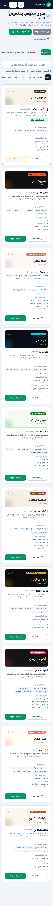
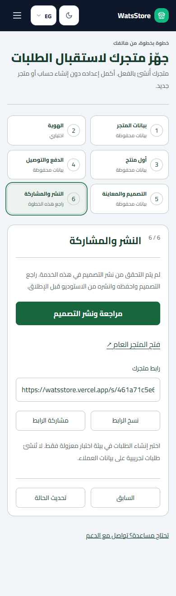

# Phase 05 theme studio QA

## Bugs found and corrected

The prior preview constrained a container rather than establishing a real browser viewport. Mobile merchants could not inspect the actual desktop breakpoint. Draft customization also shared the public appearance representation, and nested dialogs could release the parent's scroll lock prematurely.

`StorePreviewFrame` now renders the actual preview route in a same-origin sandboxed iframe: mobile up to 390 px and desktop **1280 px**, scaled to fit the available dashboard width. Origin and source checks restrict preview messages to the expected frame. Messages contain theme/customization only. This iframe isolates layout; it is not claimed to be an untrusted-origin security boundary.

The existing `CustomizationJson` column stores versioned draft, published and previous appearance snapshots. No migration or new column was added. Legacy flat JSON remains readable, and the root retains published values for older binary readers. Saving draft does not change the public response. Publish and restore change the theme and appearance together; repeated publish retains the genuine previous version. JSON is size-bounded and allowlisted; arbitrary CSS/HTML/unknown settings are rejected.

Merchant APIs return `themeStateVersion: 1`, `publishedAt` and editing capability. The frontend disables publish/restore when this capability is missing. Against an older backend it omits customization on legacy save to prevent accidental public draft updates. Expired/inactive merchants cannot save/publish.

## Tests

- Ten themes × three mobile dashboard widths × three browser engines, real inner-frame controls, mobile/desktop switch and inner width assertion.
- Actual draft/save/publish/restore lifecycle and public store match in the isolated backend.
- Five independent newly registered sector merchants publish and restore while order/stock state stays intact.
- Preview product/cart actions do not create orders, persist bags/history, post reviews or send advertising events.
- Nested focus, Escape, focus restoration, body scroll and dashboard light/dark isolation.
- Backend tests cover snapshot separation, legacy compatibility, validation and ownership/registration recovery.

Final outcomes: [release report](PHASE05_FINAL_RELEASE_REPORT.md). Production backend capability and SQL Server round-trip remain unverified. Do not enable publishing merely because a local preview or `/health` works.
