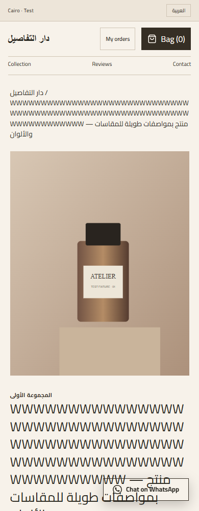
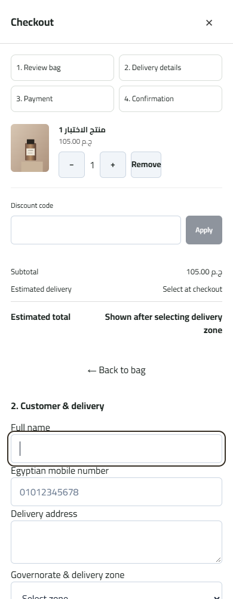

# PR49 mobile-commerce regression

Date: 2026-11-03 (Africa/Cairo). PR: [49](https://github.com/AbdallahSay/watsstore-saas/pull/49). Starting head: `4d708b78bb435070fcbfbe4a51621221ef0d603d`; master inspected at `47b39e4`.

## Reproduction and root cause

[CI run 41479308560](https://github.com/AbdallahSay/watsstore-saas/actions/runs/41479308560), checkout job `125393799438`, failed in `mobile-commerce.e2e.cjs:55:196`: the helper timed out waiting for `.ws-product-info h3 button`. The failure was reproduced against the unchanged head using a production Next build and a freshly seeded isolated SQLite API.

PR49 had already changed public product cards to dedicated product pages. The Arabic part of the test followed those links, but the English tail still expected the retired product-title button and modal. It also reloaded the current dedicated product URL after closing the order confirmation, rather than navigating back to the catalog. The rendered failure screenshot shows the English product page with an empty bag, confirming the test's navigation assumption was stale.

## Fix

The English journey now explicitly returns to the catalog, clicks the actual product-title link, waits for the expected product heading, asserts a dedicated `/p/` URL and absence of a product modal, adds from the product page and checks the English checkout review. No application behavior was reverted. No timeout was enlarged and no assertion was disabled.

All existing quantity, variant, coupon stale-response, server totals (subtotal 305, discount 30.50, delivery 45, total 319.50), merchant-order count, stock deduction, focus trap, busy Escape guard, responsive and input-size assertions remain.

## Actual verification

- Before fix: reproduced the same 30-second timeout and selector at line55.
- After fix: mobile-commerce **3/3 PASS** (editorial, streetwear, lifestyle), Arabic and English, seven viewport widths plus narrow height.
- Frontend unit regression: **34/34 PASS**, zero skipped.
- Production Next build and TypeScript: PASS at the starting application revision; this patch changes only the browser test and evidence.
- `npm ci`: dependency audit reported zero known vulnerabilities.
- Complete PR-head CI: see [PR49 checks](https://github.com/AbdallahSay/watsstore-saas/pull/49/checks). The exact resulting run/head is recorded in the PR description after completion; previous green build jobs do not prove a later browser run passed.

The screenshots and summary use isolated technical fixtures, not real merchants or customer orders. Production was not queried or modified during this reproduction. No database migration, merge, deployment, store deletion or notification activation is performed by this patch. Physical iPhone/Android testing remains unperformed.
